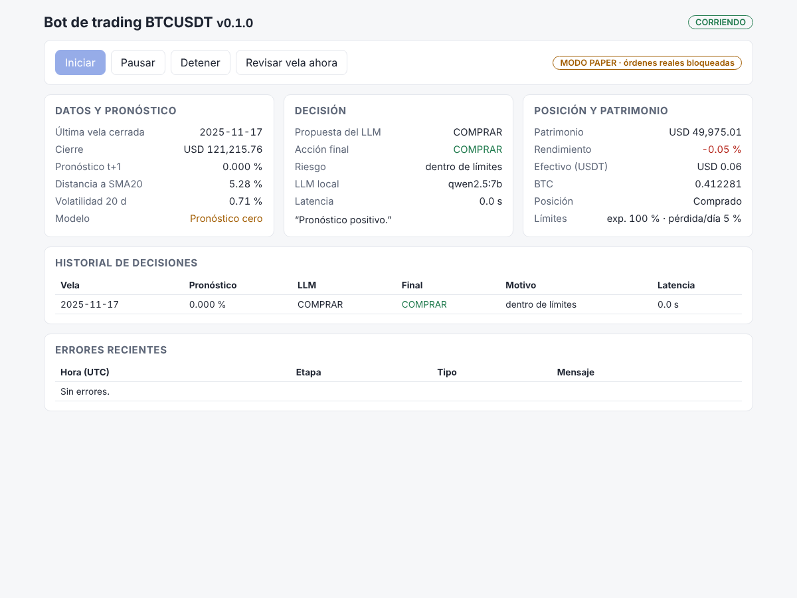
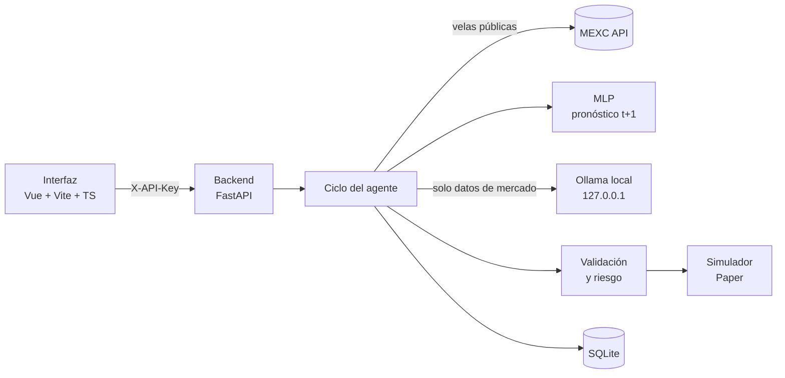

# Bot de trading BTC/USDT con LLM local

  

Agente académico que cada día lee la vela cerrada de **BTC/USDT en MEXC**, calcula un pronóstico con una red neuronal (MLP) y le pide a un **LLM que corre en la propia computadora (Ollama)** una propuesta de compra, venta o mantener. La propuesta se valida, pasa por controles de riesgo fijos y se ejecuta en un **simulador Paper** (sin dinero real).

Proyecto final de la práctica de Deep Learning para Finanzas (Prof. Rubén Miguel Rodríguez Rangel), Ingeniería en Inteligencia Artificial, Universidad Iberoamericana León.

> **Aviso:** proyecto académico. No es asesoría financiera. En v0.1 las órdenes reales están bloqueadas.



## Versión

**v0.1.0** (17 de noviembre de 2026): primera entrega funcional del bot. Ver [CHANGELOG.md](CHANGELOG.md).

## Tecnologías aplicadas

| Capa | Tecnología | Versión |
|---|---|---|
| Interfaz | Vue 3 + TypeScript | Vue 3.5, TypeScript 5.9 |
| Herramienta de compilación | Vite | 7.3 |
| Backend / API | Python + FastAPI + Uvicorn | Python 3.11+, FastAPI 0.115, Uvicorn 0.34 |
| Validación de datos | Pydantic | 2.11 |
| Cliente HTTP | HTTPX | 0.28 |
| LLM local | Ollama + Qwen2.5 7B (configurable) | Ollama 0.x |
| Modelo de pronóstico | MLP (PyTorch en Colab, inferencia con NumPy) | NumPy 1.26+ |
| Base de datos | SQLite | incluida en Python |
| Datos de mercado | API pública spot v3 de MEXC | — |
| Pruebas | pytest | 8.3 |

## Arquitectura



**Ciclo diario** (una sola decisión por vela):
1. Lee las velas diarias de MEXC y separa las cerradas de la vela en curso. Rechaza el dato si la última vela cerrada tiene más de `ANTIGUEDAD_MAX_H` horas.
2. Calcula los 20 rendimientos más recientes, la SMA de 20 días, la distancia a la SMA y la volatilidad de 20 días.
3. El MLP estima el rendimiento del día siguiente.
4. El LLM local recibe esos datos y responde en JSON: `accion` (COMPRAR, VENDER o MANTENER), `simbolo`, `fecha_vela` y `justificacion`.
5. Se valida la respuesta: JSON correcto, acción del catálogo, mismo símbolo y misma vela. Si falla, se mantiene sin operar.
6. Se aplican los controles de riesgo. El LLM no puede modificarlos.
7. Se ejecuta en Paper al precio de apertura de la vela siguiente, con deslizamiento.
8. Se guarda todo en SQLite y se muestra en la interfaz.

## Seguridad

- **No se pasa ninguna API a la IA.** El prompt se arma solo con datos de mercado, el pronóstico y el estado de la cartera, a partir de una lista cerrada de campos. Claves, rutas y variables de entorno nunca llegan al LLM, y una prueba automática lo verifica.
- **Solo LLM local.** El backend no arranca si `OLLAMA_URL` no apunta a `localhost` o `127.0.0.1`.
- **Sin claves de MEXC en v0.1.** Solo se usan endpoints públicos, y no existe código que firme peticiones ni envíe órdenes reales. `MODO` distinto de `PAPER` detiene el arranque.
- **Secretos fuera del repositorio.** `BOT_API_KEY` vive solo en `.env`, que está en `.gitignore`. La interfaz pide la clave al entrar y la guarda únicamente en la pestaña abierta.
- **API protegida.** Todas las rutas, salvo `/api/salud`, exigen el encabezado `X-API-Key`. El backend escucha solo en `127.0.0.1`.

## Controles de riesgo (en `.env`)

| Variable | Valor por defecto | Qué controla |
|---|---|---|
| `CAPITAL_INICIAL` | 50000 | USDT simulados al inicio |
| `EXPOSICION_MAX` | 1.0 | Fracción máxima del efectivo por compra (≤ 1: sin apalancamiento) |
| `PERDIDA_DIARIA_MAX` | 0.05 | Si el patrimonio cae 5 % en el día, se bloquean las compras |
| `ANTIGUEDAD_MAX_H` | 26 | Edad máxima de la última vela cerrada |
| `COSTO` | 0.0 | Comisión por operación |
| `DESLIZAMIENTO` | 0.0005 | Supuesto de deslizamiento: compra 0.05 % más cara y venta 0.05 % más barata |

También se aplican siempre estas reglas:
- No hay ventas en corto.
- No se compra si ya hay una posición abierta.
- La cantidad se redondea hacia abajo a la precisión del par.
- Se respeta el monto mínimo de orden de MEXC.

## Requisitos

- Python 3.11 o superior
- Node.js 20 o superior
- [Ollama](https://ollama.com) instalado en la misma computadora

## Instalación y uso

```bash
# 1. LLM local
ollama pull qwen2.5:7b          # o el modelo que pongas en OLLAMA_MODELO
ollama serve                     # escucha en 127.0.0.1:11434

# 2. Configuración
cp .env.example .env
python -c "import secrets; print(secrets.token_urlsafe(32))"   # pega el resultado en BOT_API_KEY

# 3. Backend
cd backend
python -m venv .venv
source .venv/bin/activate        # Windows: .venv\Scripts\activate
pip install -r requirements.txt
uvicorn app.main:create_app --factory --host 127.0.0.1 --port 8000

# 4. Interfaz (en otra terminal)
cd frontend
npm install
npm run dev                      # abre http://127.0.0.1:5173
```

En la interfaz, escribe tu `BOT_API_KEY` y presiona **Iniciar**. El bot revisa cada `REVISAR_CADA_S` segundos si ya cerró una vela diaria nueva. Con **Revisar vela ahora** puedes forzar esa revisión: si la vela ya se procesó, no hace nada. **Pausar** deja de revisar y **Detener** termina el ciclo.

**Modelo:** copia `models/modelo_mlp.json` exportado desde Colab (ver [models/README.md](models/README.md)). Sin ese archivo, el bot usa el pronóstico cero y lo indica en la interfaz.

## API

Documentación interactiva en `http://127.0.0.1:8000/docs`.

| Método | Ruta | Descripción |
|---|---|---|
| GET | `/api/salud` | Versión y modo (sin clave) |
| GET | `/api/estado` | Estado del bot, modelo, cartera, patrimonio, riesgo y último ciclo |
| POST | `/api/control/{iniciar\|pausar\|detener}` | Control del bot |
| POST | `/api/ciclo` | Revisa la vela ahora |
| GET | `/api/llm` | Versión de Ollama y disponibilidad del modelo |
| GET | `/api/decisiones`, `/api/ordenes`, `/api/errores`, `/api/patrimonio` | Historial |

## Pruebas

```bash
cd backend
python -m pytest -q
```

Son 23 pruebas. Entre ellas están los 9 errores provocados que pide el protocolo:
- API de MEXC sin respuesta o con límite de solicitudes
- Dato atrasado
- Ollama detenido
- JSON inválido del LLM
- Clave incorrecta
- Saldo insuficiente
- Evento duplicado (misma vela dos veces)
- Reinicio del backend sin duplicar operaciones
- Botón de detener

## Estructura

```
├── backend/
│   ├── app/
│   │   ├── main.py       # API FastAPI
│   │   ├── agente.py     # ciclo del agente y control (iniciar/pausar/detener)
│   │   ├── mexc.py       # datos públicos de MEXC
│   │   ├── modelo.py     # variables y MLP (NumPy)
│   │   ├── llm.py        # Ollama local + validación de la propuesta
│   │   ├── paper.py      # simulador Paper y riesgo
│   │   ├── db.py         # SQLite
│   │   └── config.py     # configuración desde .env
│   ├── tests/
│   └── requirements.txt
├── frontend/             # Vue 3 + Vite + TypeScript
├── models/               # modelo_mlp.json versionado
├── scripts/              # exportación del modelo desde Colab
├── docs/
├── .env.example
├── CHANGELOG.md
└── LICENSE
```

## Decisiones de diseño

- **Mercado:** se eligió MEXC (spot BTC/USDT) entre las opciones MEXC y Polymarket, porque el modelo de la práctica pronostica rendimientos diarios de BTC. Polymarket queda como opción a evaluar.
- **Interfaz:** Vue + Vite + TypeScript, según la recomendación del profesor.
- **Modelo:** el MLP se entrenó con datos diarios de BTC-USD de Yahoo Finance. Antes de confiar en sus pronósticos con MEXC hay que validarlo con datos de BTCUSDT de MEXC (pendiente para v0.2).

## Próximos pasos (v0.2)

- [ ] Validar el MLP con datos históricos de BTCUSDT de MEXC.
- [ ] Demostrar al menos 20 ciclos válidos y documentar los 9 errores provocados con evidencia de la interfaz.
- [ ] Comparar en el mismo periodo y con los mismos costos: modelo sin LLM, agente con LLM y comprar y mantener.
- [ ] Agregar un proxy con autenticación delante de Ollama.
- [ ] Evaluar Polymarket como segundo mercado.

## Autora

Lyzzet Valenzuela Cabello. Ingeniería en Inteligencia Artificial, Universidad Iberoamericana León.

## Licencia

[MIT](LICENSE)
